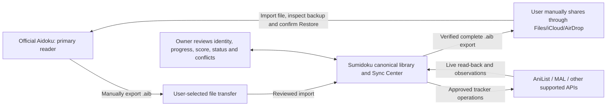
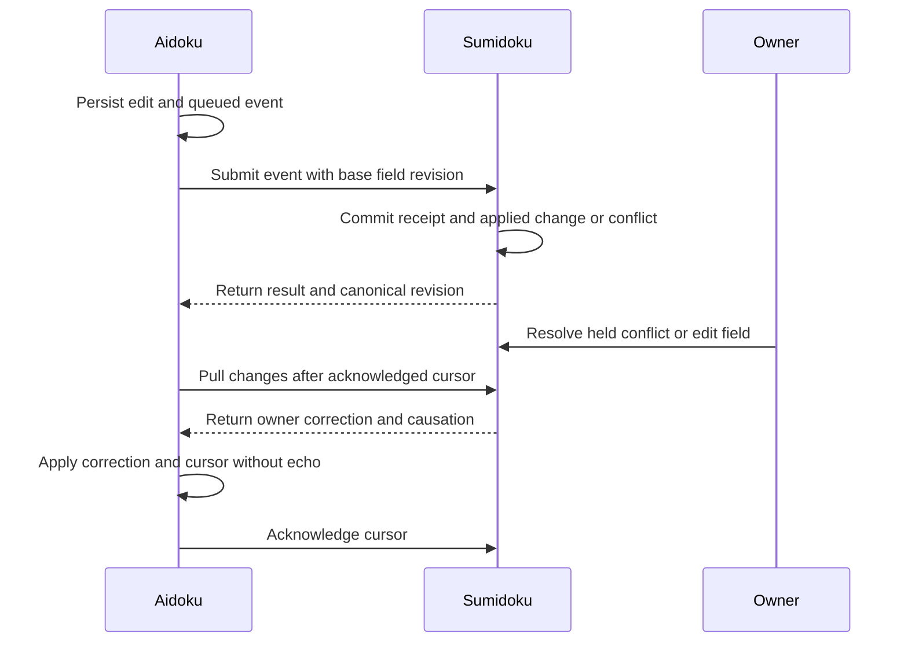

# Beta 5 — Aidoku file interoperability and authoritative tracker reconciliation

**Target** `1.3.1-beta.5`, build 14. **Status** approved *manual file-transfer* product direction, implementation and live compatibility still unverified. No live client or provider contract is qualified by this document.

**Approved Beta 5 scope:** Sumidoku is the authoritative library/reconciliation manager. Aidoku remains the primary reader and supplies user-exported `.aib` backups. Sumidoku reviews the imported library, chapter/page history and tracker links; it separately connects to tracker APIs for real remote observations and owner-approved corrections. Sumidoku may export a complete verified Aidoku-compatible `.aib` for the owner to **manually share through iCloud Drive, Files or AirDrop**, open in official Aidoku, and explicitly restore after safeguarding the current Aidoku library. This is a **manual file-based round trip**, not continuous two-way synchronization. No custom Aidoku build, upstream contribution, native app patch, automatic import, paired iPhone network service, or background sender is required for Beta 5.

**Important safety gate:** The outbound file must round-trip correctly against a disposable official Aidoku installation and preserve unrelated library records/history. If this cannot be proven, *do not offer the export as restorable*. Continue with safe Aidoku -> Sumidoku import and read-only reconciliation. Real tracker writes remain gated on explicit owner approval and provider-specific tests.

## Verified source inventory

Reviewed revisions [desktop main 015c323](https://github.com/TTokomon/SumidokuApp/tree/015c323b54dbbb046559389e41d9e187a3fe9785), [upstream Sumidoku 6df30aa](https://github.com/Sumidoku/Sumidoku/tree/6df30aaf221ddd7ddf937ae8be075f6a76ad59c3), [Aidoku 95d1468](https://github.com/Aidoku/Aidoku/tree/95d1468d599a154f03d6a1dd06bf839d3ff3f7bd), and [community sources 3d303f4](https://github.com/Aidoku-Community/sources/tree/3d303f4834adcf4a936688fa49285f3f5b293436). The community source pins [aidoku-rs ae6485e](https://github.com/Aidoku/aidoku-rs/tree/ae6485e3c14ecd1fd5497d170eae884c68d04a87) and the Aidoku app pins [AidokuRunner 2ed3f0d](https://github.com/Aidoku/AidokuRunner/tree/2ed3f0d395be0c3ee9ebe238e2ffcead0094613f). Findings are from source inspection.

| Component | Confirmed behavior and reuse boundary |
| --- | --- |
| [Community Sumidoku source v1](https://github.com/Aidoku-Community/sources/tree/3d303f4834adcf4a936688fa49285f3f5b293436/sources/multi.sumidoku) | Requires Aidoku 0.7.1 or later. Base URL and optional bearer token or username/password are reader settings. It reads the server library, manga, chapters and pages. Its login POST establishes a session. No progress, membership or backup writes are implemented. Its manga and chapter keys encode numeric server IDs and require a verified link to a specific instance and durable identity before sync. |
| [Source SDK traits](https://github.com/Aidoku/aidoku-rs/blob/ae6485e3c14ecd1fd5497d170eae884c68d04a87/crates/lib/src/structs/source.rs) and [runner host](https://github.com/Aidoku/AidokuRunner/blob/2ed3f0d395be0c3ee9ebe238e2ffcead0094613f/Sources/AidokuRunner/Source.swift) | The inspected host dispatches browsing, images, settings, login, deep links, migration and explicit source notifications. The notification callback is used for settings and system migration. The reviewed surface exposes no general reading or library mutation stream, cross-source Core Data access, native tracker registration or apply-to-library hook. Page fetches can happen without a read. Use the existing source for reading and use a separate native integration for synchronization. |
| [Aidoku native trackers](https://github.com/Aidoku/Aidoku/blob/95d1468d599a154f03d6a1dd06bf839d3ff3f7bd/Aidoku/Core/Tracking/TrackerManager.swift) | Native registration is a static list. Komga, Kavita and Suwayomi are source-scoped patterns for [PageTracker](https://github.com/Aidoku/Aidoku/blob/95d1468d599a154f03d6a1dd06bf839d3ff3f7bd/Aidoku/Core/Tracking/PageTracker.swift) chapter/page get/set and [EnhancedTracker](https://github.com/Aidoku/Aidoku/blob/95d1468d599a154f03d6a1dd06bf839d3ff3f7bd/Aidoku/Core/Tracking/EnhancedTracker.swift) automatic bindings and source cleanup. AniList, MAL, Bangumi, MangaBaka and Shikimori have separate built-in tracking implementations. Reuse native event positions and account UI patterns in Aidoku. The current page pull is date-based and ignores zero-page incomplete resets, and its queue discards updates after three failures. Implement canonical corrections and durable replay separately. |
| [Aidoku library and history services](https://github.com/Aidoku/Aidoku/tree/95d1468d599a154f03d6a1dd06bf839d3ff3f7bd/Aidoku/Core/Library/Services) | HistoryManager stores page and read changes and calls tracker hooks. MangaManager contains library mutation and refresh entry points. The native adapter must cover explicit mark-unread, download-free and cached reading, add/remove, and remote apply without echo. Audit bypass paths including restore and bulk edits. |
| [Aidoku backups](https://github.com/Aidoku/Aidoku/blob/95d1468d599a154f03d6a1dd06bf839d3ff3f7bd/Aidoku/Core/Backup/BackupManager.swift) | Creates local scheduled or manual snapshots with selectable fields, including an option for sensitive settings. [Official instructions](https://aidoku.app/help/guides/backups/) describe export/share and restore. Neither source settings nor the inspected backup manager establish a native push receiver. Reuse .aib for initial transfer and reviewed recovery. |
| [Desktop .aib importer](../crates/server/src/api/aidoku_backup.rs), [portable backup](../crates/server/src/api/backup.rs) | Reuse exact source matching, request and parser-concurrency caps, preview, recovery, and commit validation. Upstream has its own .aib importer. Keep the fork's reviewed import behavior and report unsupported fields. Initial import's additive progress rules do not implement ongoing reconciliation. |
| [Sync API](../crates/server/src/api/sync.rs), [journal](../crates/server/src/sync/journal.rs), [apply](../crates/server/src/sync/apply.rs), [compaction](../crates/server/src/sync/compact.rs) | Both Sumidoku trees implement peer replication with transaction-local journaling, ordered cursors, origin sequence deduplication, identity aliases and compaction. The existing push accepts relayed origin metadata and resolves ordinary entities using modification ordering. A device token must never reach that endpoint. Reuse store transactions, identity and journal concepts, with a separate validation and conflict layer before canonical writes. |
| [Desktop tracker adapter](../crates/server/src/tracker/mod.rs), [OAuth](../crates/server/src/tracker/oauth.rs), [worker](../crates/server/src/tracker/sync.rs), [UI](../webui/src/pages/settings/TrackersPanel.tsx) | Reuse provider search, known-title state/read, update, metadata where supported, settings, bindings and account controls. The trait has no generalized full-list pagination or remote deletion. Managed titles need a single new outbound scheduler. Existing post-commit auto-push and pull-to-other-provider behavior must be disabled for managed bindings before they receive live writes. Upstream's inspected OAuth still uses compile-time options and a default relay. The desktop fork reads runtime-only registration and binds a one-shot callback to the initiating account. Plaintext legacy token rows still exist. |

## Importing Aidoku tracker associations and reconciling provider snapshots

Aidoku's [Backup](https://github.com/Aidoku/Aidoku/blob/95d1468d599a154f03d6a1dd06bf839d3ff3f7bd/Aidoku/Core/Backup/Models/Backup.swift) optionally contains `trackItems`, separate from `history`, `chapters` and `library`. Its [BackupTrackItem](https://github.com/Aidoku/Aidoku/blob/95d1468d599a154f03d6a1dd06bf839d3ff3f7bd/Aidoku/Core/Backup/Models/BackupTrackItem.swift) contains `id` (tracker entry identifier), `trackerId` (provider name), `sourceId`, `mangaId`, an optional title, and `chapterOffset`. [BackupHistory](https://github.com/Aidoku/Aidoku/blob/95d1468d599a154f03d6a1dd06bf839d3ff3f7bd/Aidoku/Core/Backup/Models/BackupHistory.swift) separately stores chapter identity, page `progress`, `total`, `completed` and read date. Backup contents depend on selected options. An `.aib` **does not itself prove current remote tracker state or include a complete AniList/MAL account export**, and a tracker association does not authenticate the remote account.

The desktop [Aidoku importer](../crates/server/src/api/aidoku_backup.rs) already maps supported Aidoku tracker IDs (AniList, MyAnimeList, Bangumi and MangaBaka) to link records, imports offsets and read progress, and archives certain unsupported associations when recovery preservation is enabled. It preserves existing links instead of blindly replacing them, and intentionally leaves remote authentication separate. Verify provider, account, remote media ID vs list entry ID, manga edition and source identity before enabling any live write. Do not misinterpret an imported link as proof of the user's active tracker account or a remote-progress match.

**Bootstrap flow:** Import .aib with review -> inspect per-chapter/page history and imported tracker IDs -> establish independently authorized provider connections -> read each supported bound provider's live state -> compare field-by-field against Sumidoku canonical values -> propose owner corrections -> after approval, enqueue provider-compatible projections. Import must not automatically trigger API mutations, create/delete remote list entries or downgrade local page data.

**Provider granularity:** Aidoku/Sumidoku maintain page position and chapter completion; AniList/MAL and similar services generally track chapter/volume progress, scores, status and dates according to their actual API. Never infer page-level state from an integer remote chapter count or fabricate history. Treat provider account data as a separate observation, not an authoritative override. A live tracker API connection and safe reconciliation can deliver value **without upstream Aidoku approval**; only full automatic changes to stock Aidoku's private local library remain blocked by its native client hooks.

**Acceptance additions:** Use a disposable Aidoku backup with reading history, page progress, library membership and bindings to two trackers. Verify preview/apply imports source/title/remote associations and offsets without logging in or performing external writes. Then connect disposable authorized tracker accounts and confirm a read-only side-by-side comparison (including chapter offsets, score/status and missing/unknown fields). Test stale/mismatched IDs, cross-account IDs, excluded tracking in backup options, unsupported providers, and a manual downward correction; no provider write or local Aidoku mutation before separate approval.

## Approved Beta 5 path: Sumidoku-generated Aidoku backup for manual sharing

**Selected scope:** Full automatic live two-way synchronization is **out of scope for Beta 5**. Use a safe file-mediated return path with unmodified stock Aidoku. Sumidoku remains authoritative, uses Aidoku-provided snapshots for intake, reconciles live tracker observations and prepares owner-approved corrections. It could produce an Aidoku-compatible `.aib` artifact for the user to apply in Aidoku. This is *export/restore interoperability*, not direct synchronization.

**Verified official-client behavior:** [Aidoku AppDelegate.handleUrl](https://github.com/Aidoku/Aidoku/blob/95d1468d599a154f03d6a1dd06bf839d3ff3f7bd/Aidoku/App/AppDelegate.swift) accepts an opened `.aib` file and calls `BackupManager.importBackup`. That [import implementation](https://github.com/Aidoku/Aidoku/blob/95d1468d599a154f03d6a1dd06bf839d3ff3f7bd/Aidoku/Core/Backup/BackupManager.swift) **copies the file into Aidoku's Backups directory**. It does *not* apply the contents to the app's library. [BackupContentView](https://github.com/Aidoku/Aidoku/blob/95d1468d599a154f03d6a1dd06bf839d3ff3f7bd/Aidoku/Features/Settings/Backups/BackupContentView.swift) requires a separate explicit destructive Restore confirmation. During restore, BackupManager calls `clearManga`, `clearCategories`, `clearLibrary`, `clearHistory` and similar clearing operations when the corresponding backup sections are present. **A partial .aib file containing only changed records could erase existing untouched records in that section. Never advertise incremental backup import as automatic record merge.**

**Feasible without native changes:** Build a legitimate full-format .aib snapshot *only after* independently validating Aidoku's actual encoding, required fields, source IDs, record relations, and all included sections. Let the owner save or share the generated file manually to a user-approved location readable on the iPhone (iCloud Drive, Files or AirDrop). No automated transfer, Shortcuts workflow or device service is required. Delivering a file to Files is not proof Aidoku imported it; importing is not proof that Aidoku restored it. iOS sandbox/automation permissions must be respected; there is no verified Aidoku URL/deep-link API that automatically triggers backup restore.

**Minimum safe workflow:**
1. Aidoku exports a backup; Sumidoku imports it with review and records provenance. Download-free, non-destructive intake only.
2. Sumidoku reconciles chapter/page progress and tracker observations, with owner review. Existing tracker API operations can proceed separately after OAuth and approval.
3. When requested, Sumidoku offers `Export for Aidoku`, generating a **complete, validated snapshot of each section included**, not a diff or patch. Preserve identities, unrelated entries, categories, offsets, tracking links and unread/page-zero semantics; exclude secrets and device-local settings by default.
4. The owner manually shares or saves the artifact through iCloud Drive, Files or AirDrop and understands that delivery is distinct from Aidoku import and restore. The user opens the file in official Aidoku, inspects its Backup Info and explicitly confirms restore **only after making and keeping an independent current Aidoku backup**.
5. After restore, take a new Aidoku export and compare every relevant field against the approved Sumidoku snapshot. Do not silently repeat restores or overwrite newer Aidoku reads. If compatibility, completeness, or data preservation cannot be proved, **do not ship reverse export**; ship existing Aidoku -> Sumidoku transfer and read-only reconciliation instead.

**Acceptance gate:** Use disposable stock Aidoku data with multi-source library entries, chapter history and page progress, categories, tracker associations and offsets. Verify generated backup contents, intact unrelated entries, explicit manual restore, and round-trip post-restore equality. Test newer local reads, incomplete sections, missing sources, changed source keys, duplicate chapter IDs, old backups and corrupt files. A successful file delivery alone does not pass. No unsupported automation of the destructive Restore action.

**Release labeling:** Call it `Aidoku backup import and export` or `manual Aidoku transfer`, not `automatic Aidoku sync`. A true background device-to-device merge remains a **future separate project**, requiring its own decision. Beta 5 does not depend on official Aidoku upstream approval. Manual file export remains experimental until safe restore and round-trip tests pass.

## Native Aidoku integration: explicitly deferred

**Decision:** Do **not** submit an Aidoku upstream PR, build a maintained Aidoku fork, add a native tracker bridge, modify `Aidoku-Community/sources`, or add a companion iOS app for Beta 5. The existing community source remains a useful *reader* integration; an `.aib` backup remains the supported transfer boundary. A future separate proposal can revisit native `PageTracker` hooks and change streams if automatic sync becomes necessary. Preserve technical research on those limitations in the verified inventory but do not include native integration in Beta 5's requirements, milestones, implementation PRs or release promises.

No upstream maintainer approval, background device pairing, new network transport, iPhone API credentials or non-official Aidoku distribution is required for the approved workflow.

## Authority and data flow

No Aidoku-side event listener, live syncing, or automatic backup push. The user manually initiates the Aidoku -> Sumidoku and Sumidoku -> Aidoku file transfers. The outbound Aidoku restore is **not a merge**: whenever a section is present in a generated backup, its replacement contents must be complete and preflighted; partial section exports risk deleting unrelated records. All writes to AniList/MAL/etc. are separate authenticated, reviewed tracker API actions.

A canonical title uses durable verified source/manga/chapter associations, edition distinctions and provider/account-specific bindings. The tracker list-entry ID is not the same as a provider's media ID. Never match by title alone or infer per-page progress from tracker chapter counts. On each manual Aidoku backup import, compare with the last accepted snapshot and explicit owner corrections; do not treat absence from an exported subset as a deletion or override recent manual pins.

Sync Center displays accepted Sumidoku values, latest Aidoku backup observations, and current tracker API observations separately with timestamps, provenance and units. Provide **Keep Sumidoku**, **Accept**, **Edit**, **Unpin**, and **Approve tracker push**. Keep **remove local title**, **unlink tracker**, **disconnect account**, and **delete remote entry** distinct; remote deletion stays disabled by default.

## Deferred future device API v1 — NOT in Beta 5

**Archived for future research only. Do not implement, expose, call or test these endpoints as part of Beta 5.** This device API belongs to a potential future native Aidoku integration; the approved Beta 5 uses user-selected local files. If automatic sync is reconsidered in another release, re-review the protocol, threat model, scope and client feasibility before any code changes. The following table is historical design context, **not an implementation contract for build 14**.

| Operation | Contract |
| --- | --- |
| `POST /device-sync/v1/pair` | Exchange an owner-issued single-use secret with a 5-minute lifetime. Owner grants distinct `backup:upload`, `sync:push`, and `sync:pull` scopes. Return assigned device ID and generation, server epoch, credential, version and supported entity/operation set. A backup-only device gets no change feed. |
| `POST /device-sync/v1/events` | Bounded ordered batch, initially 100 events and 1 MiB. Envelope includes protocol and server epoch. Each event includes UUID, device sequence, canonical reference or explicit unmapped identity, operation, field payload, base field revision and mapping generation. Device origin and account come from the credential. Device time is display metadata. Return typed per-event receipts with current revision or review ID. |
| `GET /device-sync/v1/changes?cursor=…` | Opaque cursor bound to device, generation, negotiated scope and snapshot epoch. At most 100 ordered changes, with next cursor, has-more and server high-water indication. Deliver accepted canonical revision, operation, mapping generation and causation. The initiating device still needs canonical acknowledgments. |
| `POST /device-sync/v1/ack` | Acknowledge monotonic applied cursor only within this device's issued scope. Client saves remote changes and applied cursor together. It sends no new edit for those applied changes. |
| `GET /device-sync/v1/snapshot` | On initial setup or expired cursor, page an immutable authorized baseline with its high-water cursor. Expiry or epoch change forces resnapshot and re-review of queued local proposals. A missing record in the snapshot cannot delete local data unless the client has a matching explicit owner-approved tombstone. |
| `POST /device-sync/v1/backups` and `GET /device-sync/v1/backups/{receipt}` | Stream an Aidoku binary plist with an initial limit of 32 MiB or the existing importer byte limit, whichever is lower. Add independent decoded-object, record, nesting, memory and parse-concurrency limits before exposing remote intake. Return a device-owned receipt and redacted status. Files stay quarantined until reviewed by the owner. |

Use `401` for invalid or revoked credentials, `403` for insufficient scope, `409` with a typed reason for sequence gaps or invalid generations, `410` for an expired cursor, `413` for size limits and `429` with `Retry-After` for throttling. Reject unknown versions before decoding events. Include the failing field path and a stable reason code without echoing backup data or tokens.

The authenticated owner API lists observations, mappings, conflicts and device receipts separately. A proposed decision captures the canonical field revisions, exact external observations and suggested projection. Applying the decision requires those revisions to still match. A separate confirmation creates the outbound operation. An audit reversal uses the same decision and confirmation path. Device credentials cannot call these routes.

On reconnect, the client submits queued events without silently resetting their base revisions, then pulls canonical deltas, applies them through a distinct non-echo native transaction, and acknowledges. Keep the canonical revision and any still-unsubmitted local edit as distinct states. A pulled correction cannot discard an edit made while the request was in flight. Use a durable ordered local outbox committed with the local edit or a persisted change token from the same transaction. Transport failures retain offline edits across restart. Exponential backoff with jitter and server retry hints applies to transient failures. If the device queue is full, show that synchronization has paused and retain a detectable local reconciliation requirement. Never claim successful delivery after dropping an edit.

The hub checks exact device ID/generation, scope, cursor/epoch, supported fields, binding generation and entity version. Each accepted event commits its receipt, canonical change or held conflict, audit and eligible outbox intent in a single transaction. Retry of identical ID and bytes returns the original receipt. A reused ID with different bytes fails. Same-generation sequence gaps return the expected sequence. Identical resolved values are a no-op and still get a receipt. Receipt outcomes are `applied`, `duplicate`, `held`, `rejected`, and `retryable`. Applied/held/terminal rejected advance the accepted sequence. A retryable result pauses the rest of that batch without advancing past the event. A request with an invalid envelope performs no writes. Retry beyond retained receipts forces review of unacknowledged edits, never replay as new mutations. Retain removal generations beyond cursor compaction and require fresh enrollment/rebase on a restored server epoch.

## Field-level conflict policy for file imports and tracker observations

| Field | Intake and canonical rule | Outbound policy |
| --- | --- | --- |
| Title, chapter and tracker associations | Exact verified aliases or owner-selected match. A changed binding increments its generation, invalidates queued projections and keeps prior associations in history. | Require a matching edition and account. No writes on ambiguous identities or unavailable sources. |
| Chapter completion, unread and page | Treat completion and position as separate values. When importing a newly exported .aib, accept an unambiguous forward advance from the previously accepted backup snapshot in the same verified edition if unpinned; otherwise propose review. Concurrent forward reads can coalesce only for the same layout and progress generation. A rewind, clear, or incomparable page layout is a conflict except for an explicit owner correction. A pin survives until lifted. | Send authoritative unread and page zero only to a client proven to apply them. Trackers receive their supported chapter/volume projection, never per-page data. |
| History and timestamps | Keep reading event provenance and preserve usable local resume data. Display device time with receipt time. No invented sessions, backfilled read gaps or timestamp-based overrides. | Trackers receive no detailed reading history. Offer history correction separately from progress. |
| Membership and categories | Auto-add only a verified, unremoved title under opt-in. Hold missing titles, removals and category edits for review; a backup may exclude those sections. Explicit removal creates a generation-bound tombstone and preserves reading history and downloads. Explicit re-add creates a new generation. Missing from .aib, remote list, or incremental page is absence of evidence. | Apply approved membership delta to a capable device only. No tracker deletion cascades. Treat category names as display labels. |
| Tracker chapter/volume and status | Compare provider snapshots to last confirmed projection and canonical revision. New unrelated values surface as proposals. A stale snapshot cannot overwrite a pin. Support deliberate downward correction separately from reading-derived automation. | Show floor/offset, volume support and status mapping in the preview. Require approval for lossy mappings and coupled writes. Unsupported or unknown is distinct from zero, unset and explicit clear. |
| Score, dates and metadata | Show native scale and precision beside any normalized view. Prefer manual metadata overrides. Source metadata stays independently refreshable. Dates keep original granularity. | Use an explicit per-provider conversion; never invent dates, clear fields without permission, or treat a rounded read-back as a fresh change. Skip unsupported fields with a reason. |
| Files, caches, source packages, credentials | Device-local. Record no chapter assets or credentials in sync, audit or backups created by this feature. | No transfer of page blobs, no automated source installs, and no chapter downloads. |

Provider observations are per account/title/field. An approval binds the canonical field revision, binding/account generation, current observed remote value and exact intended payload. A serialized per-account/title worker rechecks all at execution. Where the provider has no compare-and-set, a preflight read cannot eliminate an external race. Show that limit, re-read to confirm the result, and hold divergent or ambiguous outcomes instead of asserting success. Persist outbox before remote calls, treat timeouts after writes as unknown, reconcile by read-back and retry only when safe. A stable local operation ID prevents duplicate intents. It cannot guarantee exactly-once remote execution on providers that offer no idempotency. Confirmed push echoes update the observation only. Pause on 401/re-auth or expired consent, respect 429 and Retry-After, and treat split provider writes as partial success with field-level receipts. Before enabling Sumidoku-managed provider writes, warn and verify that Aidoku's own tracker automation (where enabled) and the existing Sumidoku worker will not compete for the same account/title. Because stock Aidoku cannot be centrally reconfigured by a generated file, provide user-facing instructions and block any provider write path whose single-writer behavior cannot be proven.

Audit entries record actor/origin, old and new canonical and observed values, revision, mapping, confirmation ID, method outcome and causal parent. Reversal creates a compensating edit with current-revision preconditions. An external revert is a new reviewed push and cannot promise recovery after a remote delete, changed association or unavailable service.

## Backup and credentials

The primary transfer is **manual**: Aidoku creates/exports a `.aib`; the user moves it to the Mac and chooses Import in Sumidoku. After review and reconciliation, the user can request a complete `.aib` export from Sumidoku and manually share/save it to iCloud Drive, Files or AirDrop for opening in official Aidoku. No automatically running listener, Shortcuts server, device pairing, separate mobile API token, or private tunnel is needed.

Reuse existing authenticated local .aib intake and explicit preview/commit. Preserve original bytes, validate binary plist structure, cap archive size/decoded objects and concurrency, deduplicate safely and never import sensitive settings into runtime configuration. An Aidoku export may include sensitive settings; tell the user to exclude them and protect originals. Do not leak credentials into new generated .aib exports or logs.

For reverse export, generate complete and internally consistent records for every *included* section. Preserve unrelated titles, identifiers, categories, completed/unread and page positions, chapter/tracker references and offsets; omit sections that cannot be reproduced with verified semantics. **Omission does not mean partial section export is safe**: carefully verify how Aidoku restores each omitted field and dependency. Always ask the user to make and retain a fresh Aidoku backup before restoring a Sumidoku-generated one. Explicitly label Aidoku import (copy file into its backup list) versus Aidoku Restore (destructive replacement of sections). Never attempt to automate restore or claim continuous synchronization.

Tracker OAuth remains a separate opt-in integration. Use system browser, exact pre-registered redirect, one-use state bound to the initiating account, PKCE where supported and no secret embedded in a public build. Before any live write, establish trusted provider account identity and credential-at-rest protection, read-only verification, read-back behavior, scope and rate-limit handling. Provider registrations and real-account tests require separate approval. Never silently create/delete tracker entries, infer account identity from an imported Aidoku binding, or reuse another application's OAuth credentials.

### Provider-specific work

These are adapter observations, not live certifications. Full-account browsing needs provider-specific paginated reads and identity scopes beyond the existing per-title adapter. Initial Sync Center can start with verified linked titles and explicit search/add.

| Provider | Reuse | Required before enabling writes |
| --- | --- | --- |
| AniList | GraphQL state and mutation, score-format-aware read/write, chapter and volume, status and dates. | Registered confidential authorization-code flow. Current public docs do not support refresh tokens or granular scopes. Preserve legacy refresh compatibility only for verified legacy data, and reauthorize new connections on expiry. Verify score round-trip and integer chapter rounding against a test account. [Official auth](https://docs.anilist.co/guide/auth/) and [mutations](https://docs.anilist.co/reference/mutation). |
| MyAnimeList | v2 manga list-status forms, integer progress, score and dates. Current adapter maps rereading to reading. | Confirm current client registration, redirect, PKCE/plain and refresh behavior with official authorization docs and a test account. Surface the lossy status mapping, verify clears and account identity, and leave delete disabled until separately proven. [Adapter](../crates/server/src/tracker/providers/mal.rs). |
| Bangumi | Next API subject collection/status/score plus separate progress request. No dates in the current state adapter. | Confirm current OAuth registration and endpoint scopes. Record split write outcomes and reject silent implicit collection creation when only progress was approved. Preflight coupled status/score changes. [Official API project](https://github.com/bangumi/api) and [adapter](../crates/server/src/tracker/providers/bangumi.rs). |
| MangaBaka | REST library state, PATCH existing or POST create, rating, chapter/volume and supported date values. The fork requests S256 and provider scopes. | Confirm current registration, scopes, callback and refresh. After uncertain create, read back before retry. Prove exact date, rating and list semantics in a test account. [Adapter](../crates/server/src/tracker/providers/mangabaka.rs). |

Shikimori exists in Aidoku but has no adapter in the reviewed Sumidoku trait/provider set. Keep imported associations inactive until a separately verified adapter exists.

## Persistence, migration and rollback

The current paired desktop updater and Stable build 9 expect schema **37**. For the approved Beta 5 file workflow, **prefer the existing schema and current updater contract**. This avoids delaying manual transfer and review behind a cross-schema updater redesign. Keep historical migrations immutable and never reset existing user libraries.

If durable manual override/observation/outbound-job functionality cannot be implemented safely within current persistence contracts, provide an independent, reviewed migration/updater compatibility proposal **before** performing a schema change. No loosely coupled sidecar may claim atomic write/reconciliation guarantees that it cannot prove. A schema change is not implicitly authorized by this planning decision.

Any export or import that could replace Aidoku content must pass disposable full-library round-trip validation. Keep export files user-controlled, don't auto-upload them, and don't sign, publish or install unreviewed beta releases. Test exact Stable 9 restoration and preserved existing accounts, sources, library, reading progress, backups and downloads.

## Beta 5 implementation milestones and exit criteria — no Aidoku upstream dependency

| Milestone | Independently testable exit |
| --- | --- |
| **M0: contract check** | Pin reviewed Aidoku backup model version, verify official Aidoku import/restore mechanics on a disposable installation, and verify community Sumidoku source read-only behavior. Confirm schema-37-compatible implementation strategy. |
| **M1: Aidoku -> Sumidoku bootstrap** | Reuse existing local .aib import, preview and recovery. Verify library, sources, categories, chapter/page progress, reading history, tracker IDs and chapter offsets using representative backups; duplicates and damaged files cannot corrupt data. No outbound tracker calls. |
| **M2: authoritative review and tracker observations** | Add a usable side-by-side view of Aidoku snapshot values, Sumidoku canonical values and independently fetched provider values with explicit provenance. Confirm exact identity matching, missing/unavailable values, manual edits/pins and opt-in conflict decisions without remote writes. |
| **M3: Sumidoku -> Aidoku .aib export and manual transfer** | Generate **complete validated backup sections**, share manually via Files/iCloud/AirDrop, open in *official* Aidoku, explicitly confirm Restore, and verify a second Aidoku export agrees. Verify unrelated data intact across multiple sources, categories, page positions, chapter progress, tracker associations and offsets. If any destructive/format/compatibility gate fails, disable outbound export and document blockers; never substitute a partial-update backup. |
| **M4: tracker OAuth and controlled sync** | Enable AniList and additional providers one by one after separately approved account registrations and real tests. Confirm authorization, identity, imported association matching, read-only state, provider-specific score/status/progress mappings, review-before-write, safe retries/read-back and distinct local/unlink/remote-delete semantics. No direct Aidoku app automation. |
| **M5: Beta 5 qualification** | All features actually advertised pass regression and disposable native update + Restore Stable checks. No chapter auto-download, secret leakage, unintended remote service exposure, silent Aidoku restores or unapproved provider writes. Signed build 14 qualification/publication remains separately approved. |

**Release rule:** Beta 5 is a **manual file-based Aidoku interoperability + central tracker management** release, not a live device synchronization release. M1, usable reconciliation and M5 are required. M3 reverse export is required to *advertise* sending corrections back to Aidoku: if its official-app restore cannot preserve unrelated content, remove reverse-export claims and seek explicit approval for narrower release scope. M4 features can be enabled only for each tested provider. Upstream Aidoku approval, native PageTracker change and the deferred device API are **not** Beta 5 release gates.

## Decisions and remaining external gates

1. **Approved:** Use the official Aidoku app unchanged; manual .aib file transfer via iCloud Drive, Files or AirDrop is sufficient. Do **not** contribute to/fork Aidoku as part of Beta 5.
2. **Approved product policy:** Sumidoku is canonical; explicit manual corrections win over older imported snapshots. No silent Aidoku restore, no automatic chapter downloads, no implicit remote tracker deletes. Individual tracker pushes require explicit review and approval.
3. **Engineering default:** Preserve schema 37 for the file-based workflow; request separate approval if a verified feature needs a migration and updater compatibility work.
4. **Pending separately:** Provider OAuth registrations/credentials and any live test-account writes. These are not authorized merely by approving file transfer.
5. **Validation gate:** An outbound .aib is only a supported Beta 5 feature after verified complete snapshot restore with unchanged unrelated data in a disposable *official Aidoku* install. Do not market file sharing/import as automatic sync.

This PR changes the specification only. No app code, upstream Aidoku code, mobile networking, OAuth credentials, data, installation, release or deployment is changed.

1. Pursue the small upstream Aidoku contribution first. Approve a maintained fork only if official adoption is unavailable and its distribution, license and support obligations are acceptable.
2. Keep build 14 on schema 37 and defer durable mutation features if compatibility cannot be proven, or approve a separate Stable/updater compatibility milestone before shipping a canonical-store migration.
3. Approve the paired network path and whether an owner-run confidential OAuth exchange is acceptable. Select provider registrations and test accounts individually.
4. Confirm opt-in automatic forward progress, explicit approval for outbound corrections and remote deletions disabled by default. Approve a narrower Beta 5 release if the live-client gate remains blocked.

This PR changes the specification only. Source claims are pinned above. Real device, provider, upgrade and release acceptance remain implementation gates.
