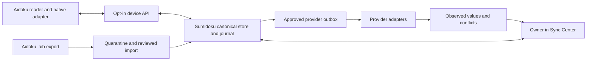
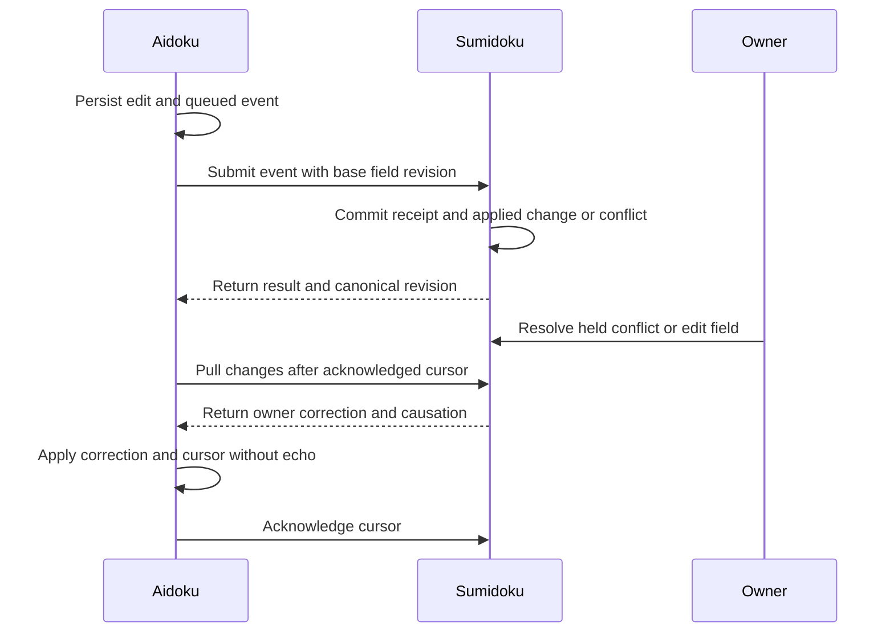

# Beta 5 authoritative synchronization specification

**Target** `1.3.1-beta.5`, build 14. **Status** design for review. No live client or provider contract is qualified by this document.

Sumidoku owns canonical state, reconciliation, audit history and approved outbound writes. Aidoku remains the primary reader and contributes local changes through a supported native client. Tracker accounts remain separate projections. An owner can compare values, choose or edit individual fields, add or remove library entries, link or unlink tracker entries, approve remote writes, and inspect or compensate prior changes.

## Verified source inventory

Reviewed revisions [desktop main 015c323](https://github.com/TTokomon/SumidokuApp/tree/015c323b54dbbb046559389e41d9e187a3fe9785), [upstream Sumidoku 6df30aa](https://github.com/Sumidoku/Sumidoku/tree/6df30aaf221ddd7ddf937ae8be075f6a76ad59c3), [Aidoku 95d1468](https://github.com/Aidoku/Aidoku/tree/95d1468d599a154f03d6a1dd06bf839d3ff3f7bd), and [community sources 3d303f4](https://github.com/Aidoku-Community/sources/tree/3d303f4834adcf4a936688fa49285f3f5b293436). The community source pins [aidoku-rs ae6485e](https://github.com/Aidoku/aidoku-rs/tree/ae6485e3c14ecd1fd5497d170eae884c68d04a87) and the Aidoku app pins [AidokuRunner 2ed3f0d](https://github.com/Aidoku/AidokuRunner/tree/2ed3f0d395be0c3ee9ebe238e2ffcead0094613f). Findings are from source inspection.

| Component | Confirmed behavior and reuse boundary |
| --- | --- |
| [Community Sumidoku source v1](https://github.com/Aidoku-Community/sources/tree/3d303f4834adcf4a936688fa49285f3f5b293436/sources/multi.sumidoku) | Requires Aidoku 0.7.1 or later. Base URL and optional bearer token or username/password are reader settings. It reads the server library, manga, chapters and pages. Its login POST establishes a session. No progress, membership or backup writes are implemented. Its manga and chapter keys encode numeric server IDs and require a verified link to a specific instance and durable identity before sync. |
| [Source SDK traits](https://github.com/Aidoku/aidoku-rs/blob/ae6485e3c14ecd1fd5497d170eae884c68d04a87/crates/lib/src/structs/source.rs) and [runner host](https://github.com/Aidoku/AidokuRunner/blob/2ed3f0d395be0c3ee9ebe238e2ffcead0094613f/Sources/AidokuRunner/Source.swift) | The inspected host dispatches browsing, images, settings, login, deep links, migration and explicit source notifications. The notification callback is used for settings and system migration. The reviewed surface exposes no general reading or library mutation stream, cross-source Core Data access, native tracker registration or apply-to-library hook. Page fetches can happen without a read. Use the existing source for reading and use a separate native integration for synchronization. |
| [Aidoku native trackers](https://github.com/Aidoku/Aidoku/blob/95d1468d599a154f03d6a1dd06bf839d3ff3f7bd/Aidoku/Core/Tracking/TrackerManager.swift) | Native registration is a static list. Komga, Kavita and Suwayomi are source-scoped patterns for [PageTracker](https://github.com/Aidoku/Aidoku/blob/95d1468d599a154f03d6a1dd06bf839d3ff3f7bd/Aidoku/Core/Tracking/PageTracker.swift) chapter/page get/set and [EnhancedTracker](https://github.com/Aidoku/Aidoku/blob/95d1468d599a154f03d6a1dd06bf839d3ff3f7bd/Aidoku/Core/Tracking/EnhancedTracker.swift) automatic bindings and source cleanup. AniList, MAL, Bangumi, MangaBaka and Shikimori have separate built-in tracking implementations. Reuse native event positions and account UI patterns in Aidoku. The current page pull is date-based and ignores zero-page incomplete resets, and its queue discards updates after three failures. Implement canonical corrections and durable replay separately. |
| [Aidoku library and history services](https://github.com/Aidoku/Aidoku/tree/95d1468d599a154f03d6a1dd06bf839d3ff3f7bd/Aidoku/Core/Library/Services) | HistoryManager stores page and read changes and calls tracker hooks. MangaManager contains library mutation and refresh entry points. The native adapter must cover explicit mark-unread, download-free and cached reading, add/remove, and remote apply without echo. Audit bypass paths including restore and bulk edits. |
| [Aidoku backups](https://github.com/Aidoku/Aidoku/blob/95d1468d599a154f03d6a1dd06bf839d3ff3f7bd/Aidoku/Core/Backup/BackupManager.swift) | Creates local scheduled or manual snapshots with selectable fields, including an option for sensitive settings. [Official instructions](https://aidoku.app/help/guides/backups/) describe export/share and restore. Neither source settings nor the inspected backup manager establish a native push receiver. Reuse .aib for initial transfer and reviewed recovery. |
| [Desktop .aib importer](../crates/server/src/api/aidoku_backup.rs), [portable backup](../crates/server/src/api/backup.rs) | Reuse exact source matching, request and parser-concurrency caps, preview, recovery, and commit validation. Upstream has its own .aib importer. Keep the fork's reviewed import behavior and report unsupported fields. Initial import's additive progress rules do not implement ongoing reconciliation. |
| [Sync API](../crates/server/src/api/sync.rs), [journal](../crates/server/src/sync/journal.rs), [apply](../crates/server/src/sync/apply.rs), [compaction](../crates/server/src/sync/compact.rs) | Both Sumidoku trees implement peer replication with transaction-local journaling, ordered cursors, origin sequence deduplication, identity aliases and compaction. The existing push accepts relayed origin metadata and resolves ordinary entities using modification ordering. A device token must never reach that endpoint. Reuse store transactions, identity and journal concepts, with a separate validation and conflict layer before canonical writes. |
| [Desktop tracker adapter](../crates/server/src/tracker/mod.rs), [OAuth](../crates/server/src/tracker/oauth.rs), [worker](../crates/server/src/tracker/sync.rs), [UI](../webui/src/pages/settings/TrackersPanel.tsx) | Reuse provider search, known-title state/read, update, metadata where supported, settings, bindings and account controls. The trait has no generalized full-list pagination or remote deletion. Managed titles need a single new outbound scheduler. Existing post-commit auto-push and pull-to-other-provider behavior must be disabled for managed bindings before they receive live writes. Upstream's inspected OAuth still uses compile-time options and a default relay. The desktop fork reads runtime-only registration and binds a one-shot callback to the initiating account. Plaintext legacy token rows still exist. |

## Importing Aidoku tracker associations and reconciling provider snapshots

Aidoku's [Backup](https://github.com/Aidoku/Aidoku/blob/95d1468d599a154f03d6a1dd06bf839d3ff3f7bd/Aidoku/Core/Backup/Models/Backup.swift) optionally contains `trackItems`, separate from `history`, `chapters` and `library`. Its [BackupTrackItem](https://github.com/Aidoku/Aidoku/blob/95d1468d599a154f03d6a1dd06bf839d3ff3f7bd/Aidoku/Core/Backup/Models/BackupTrackItem.swift) contains `id` (tracker entry identifier), `trackerId` (provider name), `sourceId`, `mangaId`, an optional title, and `chapterOffset`. [BackupHistory](https://github.com/Aidoku/Aidoku/blob/95d1468d599a154f03d6a1dd06bf839d3ff3f7bd/Aidoku/Core/Backup/Models/BackupHistory.swift) separately stores chapter identity, page `progress`, `total`, `completed` and read date. Backup contents depend on selected options. An `.aib` **does not itself prove current remote tracker state or include a complete AniList/MAL account export**, and a tracker association does not authenticate the remote account.

The desktop [Aidoku importer](../crates/server/src/api/aidoku_backup.rs) already maps supported Aidoku tracker IDs (AniList, MyAnimeList, Bangumi and MangaBaka) to link records, imports offsets and read progress, and archives certain unsupported associations when recovery preservation is enabled. It preserves existing links instead of blindly replacing them, and intentionally leaves remote authentication separate. Verify provider, account, remote media ID vs list entry ID, manga edition and source identity before enabling any live write. Do not misinterpret an imported link as proof of the user's active tracker account or a remote-progress match.

**Bootstrap flow:** Import .aib with review -> inspect per-chapter/page history and imported tracker IDs -> establish independently authorized provider connections -> read each supported bound provider's live state -> compare field-by-field against Sumidoku canonical values -> propose owner corrections -> after approval, enqueue provider-compatible projections. Import must not automatically trigger API mutations, create/delete remote list entries or downgrade local page data.

**Provider granularity:** Aidoku/Sumidoku maintain page position and chapter completion; AniList/MAL and similar services generally track chapter/volume progress, scores, status and dates according to their actual API. Never infer page-level state from an integer remote chapter count or fabricate history. Treat provider account data as a separate observation, not an authoritative override. A live tracker API connection and safe reconciliation can deliver value **without upstream Aidoku approval**; only full automatic changes to stock Aidoku's private local library remain blocked by its native client hooks.

**Acceptance additions:** Use a disposable Aidoku backup with reading history, page progress, library membership and bindings to two trackers. Verify preview/apply imports source/title/remote associations and offsets without logging in or performing external writes. Then connect disposable authorized tracker accounts and confirm a read-only side-by-side comparison (including chapter offsets, score/status and missing/unknown fields). Test stale/mismatched IDs, cross-account IDs, excluded tracking in backup options, unsupported providers, and a manual downward correction; no provider write or local Aidoku mutation before separate approval.

## Client choice and release dependency

**Recommend a narrowly scoped native upstream Aidoku integration.** Keep the WASM source unchanged. Start with a design proposal for opt-in pairing, local change capture and apply, and interoperability fixtures. A source-scoped native PageTracker adapter could prove reading for mapped Sumidoku titles. General-library sync also needs native hooks for other sources, library membership, durable offline state and explicit resets. Keep the connector code in Aidoku under its licensing terms and share protocol documents and synthetic fixtures with Sumidoku. Upstream review, user consent, and inclusion in an official distributed build are external dependencies. No upstream acceptance is assumed.

| Alternative | Scope and tradeoff |
| --- | --- |
| Stock Aidoku plus existing source and .aib file import | Works as a documented reader and manual transfer path. No demonstrated live changes on either side. Can ship as a narrower release only with explicit scope approval and honest labeling. |
| Upstream native adapter | Least invasive route to official two-way sync. Requires source review, Core Data transaction tests, maintainer acceptance and shipped-client proof. Start with a narrow capability set. |
| Maintained Aidoku fork | Can test or ship the native integration independently if approved. Requires GPL compliance, signing/distribution, updates and long-term compatibility ownership. Full official-client acceptance still needs an upstream build. |
| Shortcut or separate companion | Can relay an explicitly shared backup. A separate app cannot access Aidoku's private library store through the inspected interfaces. |
| Mimic Komga, Kavita or Suwayomi | Even a demonstrated compatibility adapter would be tied to that native source's titles and semantics. It adds a second compatibility contract and does not satisfy arbitrary-source changes or full owner correction. |

## Authority and data flow

A canonical title uses a server-issued stable identifier with durable source/manga aliases and an edition discriminator where needed. A chapter has its own durable identity. Bind each Aidoku identity `(device source, manga key, chapter key)` and each tracker identity `(provider, authenticated account, media ID)` explicitly. The provider list-entry ID is separate from the media ID. Store mapping generation and provenance. A title, cover, or chapter number can suggest a match but cannot authorize a write. Bind community numeric IDs to the authenticated instance epoch and verified catalog identities. If restore, migration, source rekey or account change makes a binding uncertain, hold entries for review and rotate the relevant mapping generation. Keep other Aidoku sources eligible through verified identifiers or explicit mapping. Preserve gaps and edition/language differences.

Sync Center shows canonical, latest observed and last confirmed projected values, together with age, provenance, units and unavailable/unsupported state. Owner choices are **Keep Sumidoku**, **Accept**, **Edit**, **Unpin**, and **Approve push** by field and destination. **Remove from library**, **Unlink**, **Disconnect account**, and **Delete remote entry** are separate actions. Unlink keeps historical observations and cancels unsent jobs. Account disconnect revokes local access and pauses its jobs. Only enable remote delete when product policy explicitly allows the provider operation and its live behavior is verified.

## Proposed device API v1

The endpoint names and initial limits below are implementation contracts for review. The owner/admin plane remains on the existing authenticated loopback application. A separate disabled-by-default HTTPS listener or private-network gateway exposes only the device routes. No source credentials or full owner API keys are accepted there.

| Operation | Contract |
| --- | --- |
| `POST /device-sync/v1/pair` | Exchange an owner-issued single-use secret with a 5-minute lifetime. Owner grants distinct `backup:upload`, `sync:push`, and `sync:pull` scopes. Return assigned device ID and generation, server epoch, credential, version and supported entity/operation set. A backup-only device gets no change feed. |
| `POST /device-sync/v1/events` | Bounded ordered batch, initially 100 events and 1 MiB. Envelope includes protocol and server epoch. Each event includes UUID, device sequence, canonical reference or explicit unmapped identity, operation, field payload, base field revision and mapping generation. Device origin and account come from the credential. Device time is display metadata. Return typed per-event receipts with current revision or review ID. |
| `GET /device-sync/v1/changes?cursor=…` | Opaque cursor bound to device, generation, negotiated scope and snapshot epoch. At most 100 ordered changes, with next cursor, has-more and server high-water indication. Deliver accepted canonical revision, operation, mapping generation and causation. The initiating device still needs canonical acknowledgments. |
| `POST /device-sync/v1/ack` | Acknowledge monotonic applied cursor only within this device's issued scope. Client saves remote changes and applied cursor together. It sends no new edit for those applied changes. |
| `GET /device-sync/v1/snapshot` | On initial setup or expired cursor, page an immutable authorized baseline with its high-water cursor. Expiry or epoch change forces resnapshot and re-review of queued local proposals. A missing record in the snapshot cannot delete local data unless the client has a matching explicit owner-approved tombstone. |
| `POST /device-sync/v1/backups` and `GET /device-sync/v1/backups/{receipt}` | Stream an Aidoku binary plist with an initial limit of 32 MiB or the existing importer byte limit, whichever is lower. Add independent decoded-object, record, nesting, memory and parse-concurrency limits before exposing remote intake. Return a device-owned receipt and redacted status. Files stay quarantined until reviewed by the owner. |

Use `401` for invalid or revoked credentials, `403` for insufficient scope, `409` with a typed reason for sequence gaps or invalid generations, `410` for an expired cursor, `413` for size limits and `429` with `Retry-After` for throttling. Reject unknown versions before decoding events. Include the failing field path and a stable reason code without echoing backup data or tokens.

The authenticated owner API lists observations, mappings, conflicts and device receipts separately. A proposed decision captures the canonical field revisions, exact external observations and suggested projection. Applying the decision requires those revisions to still match. A separate confirmation creates the outbound operation. An audit reversal uses the same decision and confirmation path. Device credentials cannot call these routes.

On reconnect, the client submits queued events without silently resetting their base revisions, then pulls canonical deltas, applies them through a distinct non-echo native transaction, and acknowledges. Keep the canonical revision and any still-unsubmitted local edit as distinct states. A pulled correction cannot discard an edit made while the request was in flight. Use a durable ordered local outbox committed with the local edit or a persisted change token from the same transaction. Transport failures retain offline edits across restart. Exponential backoff with jitter and server retry hints applies to transient failures. If the device queue is full, show that synchronization has paused and retain a detectable local reconciliation requirement. Never claim successful delivery after dropping an edit.

The hub checks exact device ID/generation, scope, cursor/epoch, supported fields, binding generation and entity version. Each accepted event commits its receipt, canonical change or held conflict, audit and eligible outbox intent in a single transaction. Retry of identical ID and bytes returns the original receipt. A reused ID with different bytes fails. Same-generation sequence gaps return the expected sequence. Identical resolved values are a no-op and still get a receipt. Receipt outcomes are `applied`, `duplicate`, `held`, `rejected`, and `retryable`. Applied/held/terminal rejected advance the accepted sequence. A retryable result pauses the rest of that batch without advancing past the event. A request with an invalid envelope performs no writes. Retry beyond retained receipts forces review of unacknowledged edits, never replay as new mutations. Retain removal generations beyond cursor compaction and require fresh enrollment/rebase on a restored server epoch.

## Field-level conflict policy

| Field | Intake and canonical rule | Outbound policy |
| --- | --- | --- |
| Title, chapter and tracker associations | Exact verified aliases or owner-selected match. A changed binding increments its generation, invalidates queued projections and keeps prior associations in history. | Require a matching edition and account. No writes on ambiguous identities or unavailable sources. |
| Chapter completion, unread and page | Treat completion and position as separate values. Auto-accept a forward advance from the current base in the same verified edition if unpinned. Concurrent forward reads can coalesce only for the same layout and progress generation. A rewind, clear, or incomparable page layout is a conflict except for an explicit owner correction. A pin survives until lifted. | Send authoritative unread and page zero only to a client proven to apply them. Trackers receive their supported chapter/volume projection, never per-page data. |
| History and timestamps | Keep reading event provenance and preserve usable local resume data. Display device time with receipt time. No invented sessions, backfilled read gaps or timestamp-based overrides. | Trackers receive no detailed reading history. Offer history correction separately from progress. |
| Membership and categories | Auto-add only a verified, unremoved title under opt-in. Hold device removals and category edits for review initially. Explicit removal creates a generation-bound tombstone and preserves reading history and downloads. Explicit re-add creates a new generation. Missing from .aib, remote list, or incremental page is absence of evidence. | Apply approved membership delta to a capable device only. No tracker deletion cascades. Treat category names as display labels. |
| Tracker chapter/volume and status | Compare provider snapshots to last confirmed projection and canonical revision. New unrelated values surface as proposals. A stale snapshot cannot overwrite a pin. Support deliberate downward correction separately from reading-derived automation. | Show floor/offset, volume support and status mapping in the preview. Require approval for lossy mappings and coupled writes. Unsupported or unknown is distinct from zero, unset and explicit clear. |
| Score, dates and metadata | Show native scale and precision beside any normalized view. Prefer manual metadata overrides. Source metadata stays independently refreshable. Dates keep original granularity. | Use an explicit per-provider conversion; never invent dates, clear fields without permission, or treat a rounded read-back as a fresh change. Skip unsupported fields with a reason. |
| Files, caches, source packages, credentials | Device-local. Record no chapter assets or credentials in sync, audit or backups created by this feature. | No transfer of page blobs, no automated source installs, and no chapter downloads. |

Provider observations are per account/title/field. An approval binds the canonical field revision, binding/account generation, current observed remote value and exact intended payload. A serialized per-account/title worker rechecks all at execution. Where the provider has no compare-and-set, a preflight read cannot eliminate an external race. Show that limit, re-read to confirm the result, and hold divergent or ambiguous outcomes instead of asserting success. Persist outbox before remote calls, treat timeouts after writes as unknown, reconcile by read-back and retry only when safe. A stable local operation ID prevents duplicate intents. It cannot guarantee exactly-once remote execution on providers that offer no idempotency. Confirmed push echoes update the observation only. Pause on 401/re-auth or expired consent, respect 429 and Retry-After, and treat split provider writes as partial success with field-level receipts. Before enabling a managed binding, confirm that matching Aidoku direct tracker writes and the legacy Sumidoku worker are disabled for that title/account. The native adapter must also suppress direct tracker writes when applying a Sumidoku correction.

Audit entries record actor/origin, old and new canonical and observed values, revision, mapping, confirmation ID, method outcome and causal parent. Reversal creates a compensating edit with current-revision preconditions. An external revert is a new reviewed push and cannot promise recovery after a remote delete, changed association or unavailable service.

## Backup and credentials

For stock Aidoku, start with Export → Save to Files or Share, then reuse the local .aib preview workflow. A user-triggered Shortcut/share upload can be a separately tested convenience, with a backup-only credential held outside shared shortcut definitions. Prove the real sender on stock Aidoku before claiming compatibility. Quarantine original bytes on an owner-only path with bounded plist parsing, content validation, per-device quotas and an explicit retention policy. Ask the sender to exclude sensitive settings and assume uploaded originals may still contain credentials. Allowlist settings the existing importer needs. Never surface sensitive fields, include them in diagnostics or new exports, or use them to register sources. Restrict access, support deletion and preserve a hash receipt. Dedupe by owner and digest while returning only device-scoped receipts. Every apply requires a fresh preview and explicit review. For already linked libraries, old backups are recovery proposals and may not re-add tombstoned entries or override newer progress or pins.

Pair only with owner confirmation, display endpoint and device scope, and store a random 256-bit bearer verifier as a digest. Give passwords and tokens separate lifecycles. Support rotate, revoke, rate limit, audit and expiration. Keep iOS secrets in Keychain. Fail closed on TLS trust and host mismatch, forbid cross-origin redirects with credentials, and never put credentials in a URL, backup, log or analytics. The bridge is off by default. Recommend an approved private network and HTTPS route limited to device endpoints. A sleeping/offline Mac pauses delivery. Any relay, listener exposure or hosted service requires separate approval.

For desktop OAuth, use the system browser, an exact pre-registered redirect, one-use expiring state bound to the initiating account, provider and callback, and PKCE where supported. Prefer a private callback or approved confidential exchange service for providers that need it. Validate the authenticated provider identity before activating a link. Test browser/WKWebView session handoff without exporting cookies or trusting arbitrary return URLs. Do not reuse another project's registration or embed secrets. Use user-scoped macOS Keychain-backed credentials through a reviewed local service interface, or authenticated ciphertext with a Keychain-held key if a storage design explicitly requires it. Define locked-Keychain behavior, disconnect and refresh races, and upgrade/recovery before deployment. Existing plaintext legacy rows require a reviewed reconnect or migration plan that prevents live use by the older runtime after rollback. Keep bindings and require explicit reauthentication where credentials cannot safely cross versions. Keep provider logging status-only and redact third-party error content.

### Provider-specific work

These are adapter observations, not live certifications. Full-account browsing needs provider-specific paginated reads and identity scopes beyond the existing per-title adapter. Initial Sync Center can start with verified linked titles and explicit search/add.

| Provider | Reuse | Required before enabling writes |
| --- | --- | --- |
| AniList | GraphQL state and mutation, score-format-aware read/write, chapter and volume, status and dates. | Registered confidential authorization-code flow. Current public docs do not support refresh tokens or granular scopes. Preserve legacy refresh compatibility only for verified legacy data, and reauthorize new connections on expiry. Verify score round-trip and integer chapter rounding against a test account. [Official auth](https://docs.anilist.co/guide/auth/) and [mutations](https://docs.anilist.co/reference/mutation). |
| MyAnimeList | v2 manga list-status forms, integer progress, score and dates. Current adapter maps rereading to reading. | Confirm current client registration, redirect, PKCE/plain and refresh behavior with official authorization docs and a test account. Surface the lossy status mapping, verify clears and account identity, and leave delete disabled until separately proven. [Adapter](../crates/server/src/tracker/providers/mal.rs). |
| Bangumi | Next API subject collection/status/score plus separate progress request. No dates in the current state adapter. | Confirm current OAuth registration and endpoint scopes. Record split write outcomes and reject silent implicit collection creation when only progress was approved. Preflight coupled status/score changes. [Official API project](https://github.com/bangumi/api) and [adapter](../crates/server/src/tracker/providers/bangumi.rs). |
| MangaBaka | REST library state, PATCH existing or POST create, rating, chapter/volume and supported date values. The fork requests S256 and provider scopes. | Confirm current registration, scopes, callback and refresh. After uncertain create, read back before retry. Prove exact date, rating and list semantics in a test account. [Adapter](../crates/server/src/tracker/providers/mangabaka.rs). |

Shikimori exists in Aidoku but has no adapter in the reviewed Sumidoku trait/provider set. Keep imported associations inactive until a separately verified adapter exists.

## Persistence, migration and rollback

Stable build 9 and the current paired updater require the target schema to equal the live schema. Current schema is 37. A standard migration on the main database would block both the existing updater's install check and same-data Restore Stable. Preserve migration checksums and keep build 14 on schema 37 while the existing updater contract stands. [Paired installer schema check](../macos/App/PairedInstallation.swift).

- First deliver local file transfer and observation/review with existing schema or a versioned private sidecar containing only disposable/cache/receipt state that does not claim atomic canonical writes. A sidecar may hold quarantined backup files and read-only observations. Retain original file and recheck freshness at commit using existing import APIs.
- For durable bidirectional writes, the recommended integrity design stores receipts, pins, tombstones and outbox in the canonical transaction. Implementing it with a standard schema migration requires an approved compatibility plan and a qualified updater-capable Stable baseline before it can ship. A versioned schema-37 sidecar for writes is a research alternative only if its commit/recovery protocol proves exactly one canonical outcome, independent of SQLite WAL cross-database atomicity, and safely represents no-ops and compacted journal entries. Prefer feature deferral over a silent weak persistence shortcut.
- On disable, backup restore or rollback, fence all workers and stale approvals, drain or record uncertain remote writes, and persist a new server epoch on restore before accepting device traffic. Reauthorize when bindings and revision continuity cannot be proven. A previous build must never replay Beta's sidecar or consume new credentials. Test that old auto-push settings are safe before restoring Stable and verify chosen credentials cannot become usable by the old tracker worker unexpectedly.
- Use account and source-preserving portable export and disposable backup/restore tests. No destructive reset to install an app update, historical migration rewrite, or extraction of private data into qualification artifacts.

## Implementation milestones and exit criteria

| Milestone | Independently testable exit |
| --- | --- |
| M0: approve client strategy, release scope, persistence and provider credentials | Pin source versions. On disposable instances verify the stock community source browses/reads, including numeric-ID behavior after a restored/recreated database. Prove remaining hook availability against a named Aidoku binary or open an approved upstream design review. Record exact capability and blockers. |
| M1: file bootstrap and scoped backup intake | Real stock Aidoku .aib export and reviewed import. Prove byte retention, dry-run parity, old/repeated backup handling, no accidental source installs, oversized/corrupt archive rejection, unrelated-device receipt denial, expired/revoked token handling, and restart recovery. Demonstrate install rollback on the unchanged schema. |
| M2: identity, review and protocol fixtures in shadow mode | Exercise community and unrelated-source mappings, ambiguous identity, duplicate IDs with different bodies, sequence gaps, stale generations, concurrent reviews, compaction, lost responses and crash recovery. No outbound tracker writes. |
| M3: native Aidoku device pilot | On a named authorized build, offline read, cached page, close/relaunch, reconnect and replay. Demonstrate chapter/page updates and reset/mark-unread in both directions, explicit add/remove/re-add, and no echo or false new events on remote apply. Inspect app permission and distribution requirements. Stock acceptance requires a publicly obtainable official build with the hooks. |
| M4: provider accounts and reconciliation | Land read-only connection first, then opt-in writes provider by provider. Live disposable accounts prove login, reconnect/expiry, revocation, exact identities, score/status/progress round-trip, unauthorized or stale approval rejection, split-write or timeout reconciliation, corrected playback without a second writer, and a compensating edit. Provider features that fail remain unavailable. |
| M5: release qualification | All advertised paths pass real-client tests, required CI and disposable native app/server update and Restore Stable checks preserving current data. Prove no automatic chapter downloads, no credential leakage, disabled-by-default device exposure, and unchanged Stable/previous Beta assets. Qualify exact signed build 14 artifacts through the existing protected process before requesting publication. |

**Release rule.** If Beta 5 is advertised as bidirectional, M3 must pass end to end on the promised distribution and M2 persistence/rollback guarantees must be proven. Enable only providers and operations that pass M4. M1 and M5 are mandatory for either scope. If native upstream delivery or schema-compatible durable writes misses the release, ship a narrower file-transfer/read-only release only after explicit approval and remove live-sync claims from UI and release notes.

## Decisions requiring approval

1. Pursue the small upstream Aidoku contribution first. Approve a maintained fork only if official adoption is unavailable and its distribution, license and support obligations are acceptable.
2. Keep build 14 on schema 37 and defer durable mutation features if compatibility cannot be proven, or approve a separate Stable/updater compatibility milestone before shipping a canonical-store migration.
3. Approve the paired network path and whether an owner-run confidential OAuth exchange is acceptable. Select provider registrations and test accounts individually.
4. Confirm opt-in automatic forward progress, explicit approval for outbound corrections and remote deletions disabled by default. Approve a narrower Beta 5 release if the live-client gate remains blocked.

This PR changes the specification only. Source claims are pinned above. Real device, provider, upgrade and release acceptance remain implementation gates.
