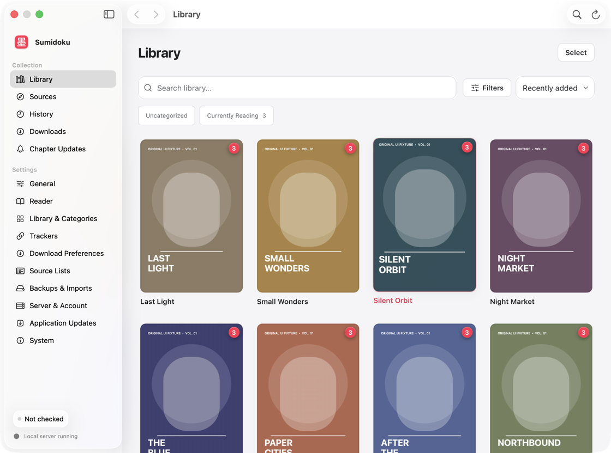
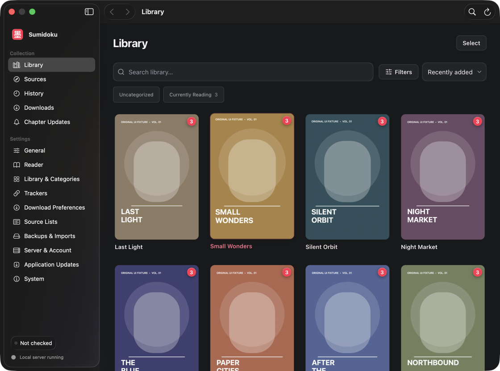
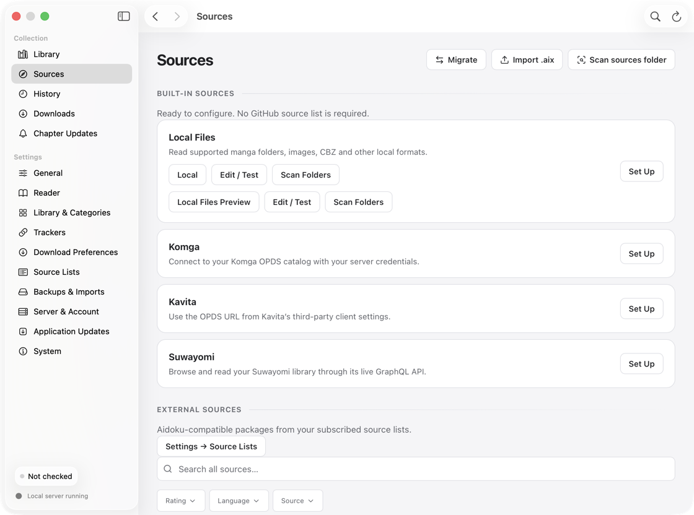
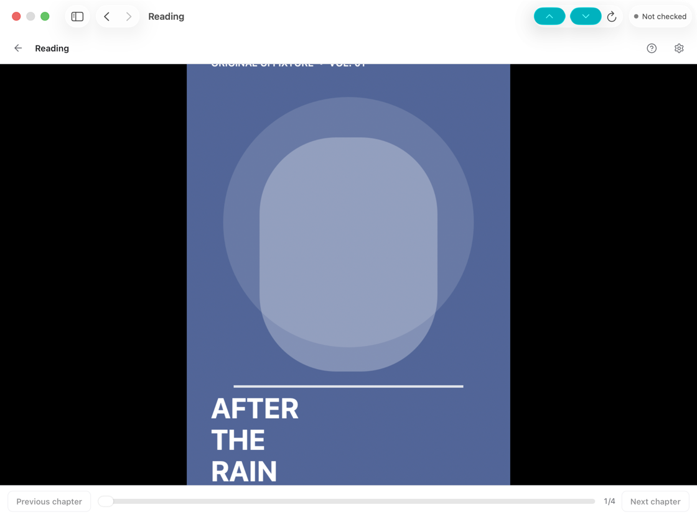
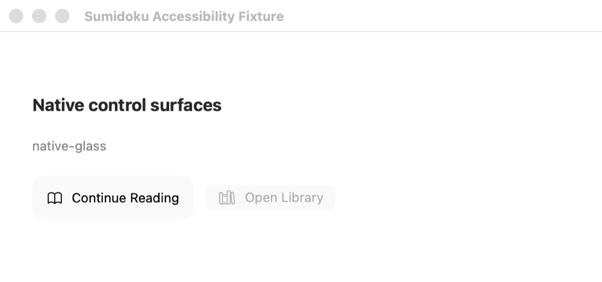
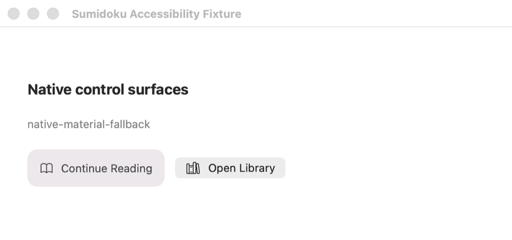
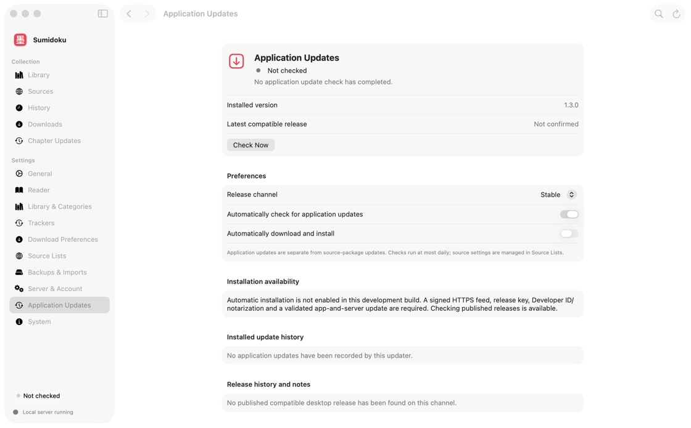

# Native desktop design and application updates

This change deliberately excludes default repository subscriptions and source-package
refresh/update policy. Their existing APIs and behavior remain intact. Application
updates have their own model, controls and status, separate from source and chapter
updates.

## Design references and licensing

The visual reference is Aidoku's current content-first library, rounded covers,
compact controls and reader navigation. The macOS adaptation uses a real sidebar,
title bar, toolbar, SF Symbols, menus, hover states and keyboard navigation rather
than an enlarged phone tab bar. System typography, neutral surfaces and a restrained
teal accent keep covers and reading pages dominant.

References reviewed:

- [Aidoku repository](https://github.com/Aidoku/Aidoku), [website/screenshots](https://aidoku.app/)
  and [release notes](https://aidoku.app/release-notes/).
- [Aidoku GPL-3.0 license](https://github.com/Aidoku/Aidoku/blob/main/LICENSE).
  No Aidoku source code, manga artwork, logos or screenshots were copied into the
  implementation. The original icon and disposable geometric comic fixtures are
  independent assets. Existing Sumidoku attribution and license files are retained.
- [Apple: applying Liquid Glass](https://developer.apple.com/documentation/swiftui/applying-liquid-glass-to-custom-views).
- [Sparkle programmatic SwiftUI integration](https://sparkle-project.org/documentation/programmatic-setup/)
  and [security/distribution setup](https://sparkle-project.org/documentation/).
  Sparkle 2.10.1 is fetched from its official release with a pinned SHA-256;
  its complete distribution license notices are in `macos/Distribution/Sparkle-LICENSE.txt`
  and copied into the application. Private release keys are never downloaded or generated.

## Native and web boundaries

| Surface | Implementation |
| --- | --- |
| Sidebar, title bar, toolbar, menus, navigation, application status | Native SwiftUI/AppKit; SF Symbols; back/forward state and native keyboard shortcuts |
| Liquid Glass status surface and reader toolbar controls | Actual `glassEffect`, `GlassEffectContainer`, and `.buttonStyle(.glass)` on macOS 26+ |
| Older supported systems | Native `.regularMaterial` and bordered controls, not CSS imitation |
| High contrast / reduced transparency | Opaque native surfaces and readable borders; web contrast rules retain labels |
| Reduced motion | Native navigation transactions omit animation; web motion rules disable transitions and staggered effects |
| Welcome/create/sign-in, server/account settings, application Updates | Native SwiftUI |
| Library grids, manga/chapter/progress, browse/search, sources/connections, Source Lists, history, backup/import, reader pages and detailed reader settings | Existing React/WKWebView content, restyled with opaque neutral surfaces and system typography |
| Web icons | Consistent existing Lucide family/weight; native chrome uses real SF Symbols |

The web presentation does not implement Liquid Glass. Existing CSS backdrop blur and
decorative blurred cover backgrounds were removed. Native mode hides the duplicate
web navigation; a narrow origin-checked bridge sends local navigation and appearance
changes between the native shell and React. Web-only access retains its own sidebar.
Explicit saved light/dark preferences survive; otherwise appearance follows the system.

The development machine runs macOS 26. The installed Xcode provides the macOS 27 SDK,
so the build uses that SDK with APIs introduced in 26 and runtime availability guards;
it does **not** claim to have been compiled against an unavailable macOS 26 SDK.
The deployment target remains macOS 13. Older runtime behavior is covered by policy
and forced native fallback checks; it still needs testing on an actual older Mac.

## Application update functionality

| Feature | Current development build |
| --- | --- |
| Application menu → Check for Updates | Operational published-release check and native Updates window |
| Settings → General → Updates / Check Now | Operational; the web General control opens the same native updater |
| Manual / optional daily automatic checks | Operational, cancellable, ETag-cached, no GitHub login |
| Stable and optional prerelease selection | Operational; drafts, server-only assets and incompatible architecture are excluded |
| Installed/latest versions, release notes/history | Operational from explicitly published matching desktop releases; local install journals shown separately |
| Green | Only a successful matching-version check for a published non-development build |
| Orange | A newer published desktop release is found; installation still requires authenticity/compatibility checks |
| Gray | Not checked, checking, offline, no compatible published release, or an unreleased development build |
| Red | Actual malformed/failed release information requiring attention; offline is not falsely shown as red |
| One-click or unattended download/installation | **Not enabled**: release signing/feed/notarization and the coordinated Sparkle handoff need signed end-to-end certification |

The small status control has text and accessibility labels, opens Updates and never
calls an older version “expired.” Application/source/chapter update states are separate.
No push, commit, branch or draft PR is treated as a release. No public release or
appcast is published by these build tools. The repository currently has no production
update feed/key configured; an empty catalog cannot produce a false green status.

`Sparkle.framework` is embedded and linked through its supported SwiftUI controller.
The current build does not start Sparkle's scheduler/installer. A non-configurable
coordinated-installation safety gate additionally prevents an Info.plist flag alone
from enabling an unsafe GUI-only update. Disabled automatic-install controls explain
this limitation rather than pretending unattended installation works.

## Paired application/server update contract

`macos/Distribution/update_transaction.py` implements the independently tested
activation stage behind the release gate:

1. Require a trusted Developer ID team, valid complete application signature and
   successful Gatekeeper assessment; reject ad-hoc/unsigned artifacts.
2. Validate application identity/version, matching bundled fork-server digest and
   known database schema compatibility. Reject unknown or backward schema changes.
3. Stop the existing service; retain a private cold Server snapshot, client, runtime
   and LaunchAgent, and verify database/user/library/source/preferences fingerprints.
4. Replace matching app/server artifacts without changing the data directory or
   creating a second service. Start the same service and require health **and**
   authenticated owner verification before recording success.
5. Keep recovery copies and a private phase journal. Cancellation or unchanged-schema
   failure can restore artifacts without replacing the database. A migrated/changed
   database stays stopped for explicit review; no automatic database downgrade or
   unsafe “reversible migration” promise is made.

This stage is tested using disposable applications, SQLite databases and injected
service/authentication fixtures. It is not yet certified as a live Sparkle termination,
installer/relaunch and paired-server upgrade on signed public releases. That certification
and signing/feed infrastructure are explicit blockers to enabling installation. No
existing personal library is used to simulate an update.

For a future approved release, provision Developer ID/notarization and an Ed25519 key
in the owner's Keychain. Use a dedicated `app.sumidoku.desktop.release` account with
Sparkle's `generate_keys`; embed **only the public key** and an HTTPS feed URL through
`SUMIDOKU_UPDATE_PUBLIC_KEY`, `SUMIDOKU_UPDATE_FEED`, and `SUMIDOKU_RELEASE_TEAM`.
Versioned release builds use `SUMIDOKU_RELEASE_BUILD=1` and may set the full prerelease
identifier with `SUMIDOKU_RELEASE_VERSION`. Never commit private keys or Apple credentials.

`macos/Distribution/prepare-release.sh APP OUTPUT` refuses unprovisioned/ad-hoc bundles,
creates a local paired-app archive and uses Sparkle's supported `sign_update` and
`generate_appcast`. Review, notarization and explicit publication approval remain
separate. Neither this script nor the application disables Gatekeeper, TLS verification
or library validation. The native build signs nested Sparkle executable leaves/bundles
before the parent framework/application for a supplied Developer ID identity.

## Local verification and screenshots

Run frontend checks/build before server checks or the Rust release build; do not
regenerate `webui/build` midway through embedded-asset tests. Bound test/compiler
concurrency to avoid resource-related cancellations.

```sh
cd webui && npm ci && npm run check
node --test --test-concurrency=4 'tests/*.test.ts'
npm run build
cd ..
cargo nextest run --workspace --no-fail-fast
cargo clippy --workspace --all-targets -- -D warnings
./macos/test-updates.sh
python3 -m unittest discover -s macos/tests -p 'test_*.py'
./macos/test-app.sh
./macos/test-onboarding.sh
./macos/test-onboarding.sh --launchagent
./macos/test-welcome.sh
python3 macos/test-desktop.py
```

The desktop renderer creates an isolated local library with original geometric CBZ
fixtures and checks native navigation plus library, details, sources, Source Lists,
history, backup/import, reader and native settings/update surfaces. On macOS 14.4+
`OwnWindowCapture` uses Apple's documented `SCShareableContent.currentProcess` API,
checks both the actual window ID and owning PID, and captures only this app's window.
If that stream fails, Apple's `screencapture` utility is restricted to the same
application window ID; it never receives a screen or region capture request.
It never requests general screen recording or captures other applications. The Mac
must be unlocked for the compositor to provide a full native-window image. View-cache
renders while locked can omit layer-backed content and are not accepted as visual proof.

The installed application supports an explicit diagnostic self-capture:

```sh
open /Applications/Sumidoku.app --args --capture-window /tmp/Sumidoku-Sources.png --capture-route /browse
```

`native:updates` and `native:server` select native panes for this diagnostic. No capture
occurs during ordinary launch. Do not publish captures containing personal library,
server, account or backup information. Public examples must use disposable fixtures.

## Verified development results

- Rust workspace: 1,272 passed, 2 skipped; strict all-target workspace clippy passed.
- Frontend: 377 passed; TypeScript check and production build passed.
- Native updater/material policies: 37 assertions; navigation: 12 cases.
- Python maintenance/paired-update fixtures: 19 tests.
- Onboarding: 32 assertions for each direct-process and temporary LaunchAgent driver.
- Welcome/create/sign-in native rendering passed without creating a real account.
- Full native fixture-window rendering passed for light/dark library, manga details,
  Sources, Source Lists, history, backups, reader, Updates and server settings, plus
  actual glass, forced material fallback, reduced transparency and increased contrast.
  System compositor captures were inspected; fixture data is disposable and original.
- Older macOS hardware, public Developer ID/notarization, signed feeds and live
  Sparkle paired installation are not certified by these local checks.

### Native-window examples

These are system captures of the running native application shell with disposable
comic fixtures, resized for documentation. No personal library data is included.










The empty-catalog regression was deliberately broken from the committed green
state: returning green for no published desktop releases failed the targeted test.
A single-file restore returned all 37 assertions to green.
