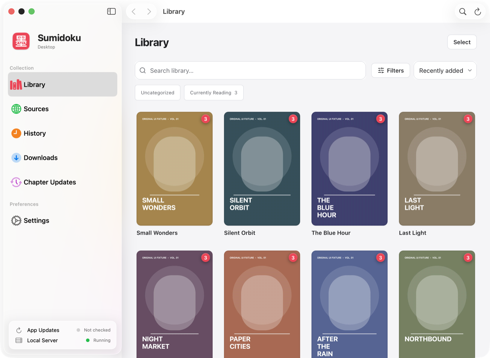

# Sumidoku Desktop 1.3.1 (7) — navigation and Settings review

PR #4 reorganized the existing native shell and upstream web components.
It does not change backend APIs, database schemas or persistent storage formats.
The installed 1.3.0 (6), managed server and personal data remain untouched.

## Design and ownership

Collection remains Library, Sources, History, Downloads and Chapter Updates.
The original 48pt Sumidoku logo, red accent, native Liquid Glass and accessibility
fallbacks remain. Navigation glyphs are 18pt, with comfortable 44pt rows.

| Preferences | Contents and canonical sections | SF Symbol |
| --- | --- | --- |
| General | Appearance, language, app version/update checks (`general`) | `gear` |
| Reader | Reading defaults, gestures, layout, background, incognito (`reader`) | `book.fill` |
| Automation | Library/metadata schedules, exclusions, source-list/package policies (`automation`) | `calendar.badge.clock` |
| Storage & Backups | Download options/location/movement (`downloads`); import/restore/schedules (`backups`) | `externaldrive.fill` |
| Accounts & Integrations | Password/security/API keys (`accounts`); providers/default/bindings (`trackers`) | `person.crop.circle.fill` |
| Server & Diagnostics | Native controls, cache, logs/runtime/About (`system`) | `gearshape.2.fill` |

Collection glyphs remain `books.vertical.fill`, `globe`, `clock.fill`,
`arrow.down.circle.fill` and `clock.arrow.2.circlepath`. Footer App Updates uses
`arrow.clockwise`; Local Server uses `server.rack`. All thirteen resolve distinctly,
including forced preferred-symbol-unavailable fallback tests. Browser Lucide
navigation glyphs are also distinct. No artwork or icon library was added.

Library now owns **Organize** (the existing category/filter editors) and
**View Options** (the existing display settings). Search, chips, sort, filtering
and multi-selection remain immediately available. Sources has URL-addressable
**Installed / Discover / Source Lists / Trash** views and its existing Search
Sources action. Built-ins and package controls stay contextual. Source Lists owns
subscriptions and manual refresh/update actions; automatic policies live only in
Automation. Tracker controls live only in Accounts & Integrations.

Settings search links to groups and contextual management. Desktop avoids a
second category bar; only Storage and Accounts have subsection controls. Compact
browser layouts retain category navigation. Native Settings shortcuts point at
the same canonical interfaces; forgot-password recovery remains available.

## Compatibility and backup recovery

All eight historical sections remain valid. `library` redirects to
`/library?panel=organize`; `source-lists` to `/browse?view=lists`. `trackers` selects
Accounts, and `downloads`/`backups` select their respective Storage subsections.
General, Reader and System retain their URLs. Native selection, root Settings,
deep links and browser back/forward use the same mapping.

An authenticated layout-scoped, memory-only Aidoku import session retains the
original File, preview, confirmations and exact selected package keys across
actual page unmounts. Source Lists navigation uses the SPA, including native
shortcuts. Resume rechecks the same bytes; logout/layout teardown clears the
session. No files or credentials are copied into persistent browser storage.

## Verification

Focused TypeScript and 69 relevant frontend tests pass. Eight native Python
regression tests, twelve local-origin policy cases, and the actual AppKit symbol
checks pass (11 destinations; 13 distinct current and forced fallback resolutions).

The disposable native WKWebView run passes eleven destinations, nine legacy/root
links, both footer controls, six categories/eight canonical panels, back/forward,
category create/rename/reorder/delete, filter-group create/edit/delete, persisted
Library/source policy settings, Settings search and exact-file Aidoku recovery
with preserved package choices across Source Lists navigation. It compares fixture
library/progress before and after organization. Tracker controls use an explicit
local fetch fixture: default provider, callback cleanup, disconnect confirmation
and binding removal. This is not live provider authentication certification.

The one production native application build passed as **1.3.1 (7)** from
implementation commit `2c754e1`. Strict nested signature verification and
byte-for-byte parity of all six embedded frontend files pass. Automatic application
installation flags remain false. Later changes contain evidence, test descriptions
and trailing-blank-line cleanup only; executable source is otherwise identical.
The final native run passed the same checks and captured exactly one light and one
dark window, both visually inspected with all Preferences labels and footer controls
visible. These are disposable native fixture windows, not the personal library.

The duplicate-symbol guard was broken from committed green by assigning Automation
the Reader symbol: it failed with `12 != 13`. A one-file git restore returned all
eight guards to green. The final sidebar-only frontend follow-up passed 10 tests,
including contextual legacy redirect assertions (part of the original 69).
Existing native fixture `onChange` deprecation and frontend chunk-size warnings
remain nonblocking.

```sh
npm --prefix webui run check
(cd webui && node --test tests/sidebar-layout.test.ts tests/settings-layout.test.ts tests/source-lists.test.ts tests/desktop-design.test.ts tests/settings-import.test.ts tests/i18n.test.ts tests/browse-search.test.ts tests/library-toolbar.test.ts tests/library-selection.test.ts tests/library-prefs.test.ts tests/trackers.test.ts tests/tracker-presentation.test.ts tests/settings.test.ts tests/chapter-cache-sources.test.ts)
python3 -m unittest macos.tests.test_sidebar_131 macos.tests.test_aidoku_symbols
./macos/test-symbols.sh
./macos/test-app.sh
CARGO_BUILD_JOBS=1 ./macos/build-fork.sh
SUMIDOKU_TEST_APP="$PWD/dist/native/Sumidoku.app" \
  SUMIDOKU_SERVER_BINARY="$PWD/dist/fork/sumidoku-server" \
  SUMIDOKU_TEST_SIDEBAR_ONLY=1 python3 macos/test-desktop.py
```

The fixture reads version and build metadata from the supplied app bundle. It
starts the supplied server binary on a temporary localhost port with an isolated
configuration and database. External tracker calls are
intercepted in the test harness, never production code. The local source index
matches the fixture backup by exact ID; no source package or manga chapter is
automatically downloaded. Use `SUMIDOKU_TEST_NO_CAPTURE=1` for behavior-only work.

## Implementation files

- `macos/App/{DesktopShell,DesktopDesign,SumidokuApp}.swift`: native routes, unique
  symbols/fallbacks, canonical settings shortcuts and application version bridge.
- `webui/src/pages/settings/{navigation,SettingsLayout,SettingsSections,SettingsSection}.tsx`
  (navigation is `.ts`): grouped routing, search and reused settings sections.
- `webui/src/pages/library/LibraryManagement.tsx`, `LibraryPage.tsx`: contextual editors.
- `BrowsePage.tsx`, `settings/SourceLists.tsx`: four source views and policy ownership.
- `settings/{AidokuImportSession,AidokuSourceRecovery}.tsx`, `layout/AppLayout.tsx`:
  cross-page import state. Browser sidebar, bridge, styles and ten locales follow
  the new groups. Focused web/native tests and fixture drivers cover these paths.

## Cleanup and limits

Superseded monolithic Settings navigation/editor ownership and the duplicate
native change-password sheet were removed by moving existing controls to their
canonical homes. Useful automated tests remain. Earlier cleanup is inventoried in
the staged review directory's historical `cleanup.json`. This revision replaced
only the previous verified review app (`250c0c4`), two canonical screenshots,
verification JSON and six obsolete verification logs with the new results; README
and artifact manifest were refreshed. Exact paths/reasons are in the local
`navigation-cleanup.json`. Historical selection-regression logs and folder metadata
remain. No additional broad filesystem cleanup was performed. Finder repeatedly
reattached metadata to Sparkle sub-bundles in Documents after cleanup. The final
review app was staged outside Documents and passes strict nested signature checks;
the redundant Documents app copy was removed and recorded in the inventory.
Screenshots and verification logs remain in the project review directory. No
Gatekeeper policy or quarantine settings were changed.
No personal data, installed sources, credentials, backups or installed app are removed.

Full Rust/Clippy, the complete frontend suite and remote CI are not certified on
this head; mandatory merge gates remain incomplete. Actual older macOS hardware,
live tracker OAuth/reconnect and reboot behavior remain separate checks. The local
app is ad-hoc signed and not notarized. Automatic app installation stays disabled.
No installation, service activation, merge or release is authorized by this review.
The staged bundle includes the matching fork executable, but this review does not
activate it. The installed background service still serves its existing frontend;
reviewing the changed web surfaces uses the disposable matching backend. A later
approved coordinated app/backend update is required for those surfaces in the
personal installation.

## Design references

[Aidoku grouped settings](https://github.com/Aidoku/Aidoku/blob/main/Aidoku/Features/Settings/Settings.swift)
and [searchable settings](https://github.com/Aidoku/Aidoku/blob/main/Aidoku/Features/Settings/SettingsView.swift)
informed grouping/search; no upstream code or branded artwork was copied.
[Mihon categories](https://mihon.app/docs/guides/categories) and
[tracking](https://mihon.app/docs/guides/tracking) informed contextual Library
management versus global provider configuration.
[Apple sidebar guidance](https://developer.apple.com/design/human-interface-guidelines/sidebars)
informed compact native groups, familiar symbols and resizing.

## Review images



