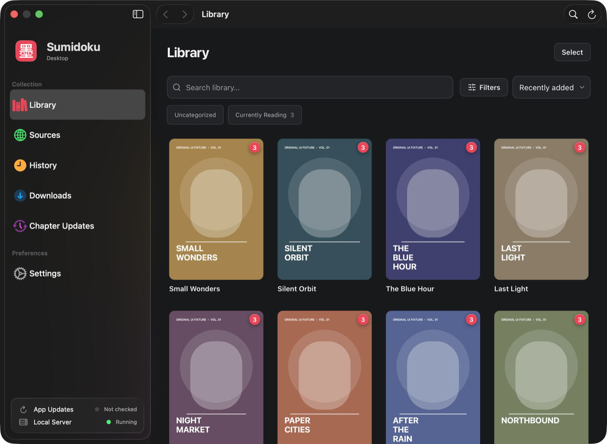
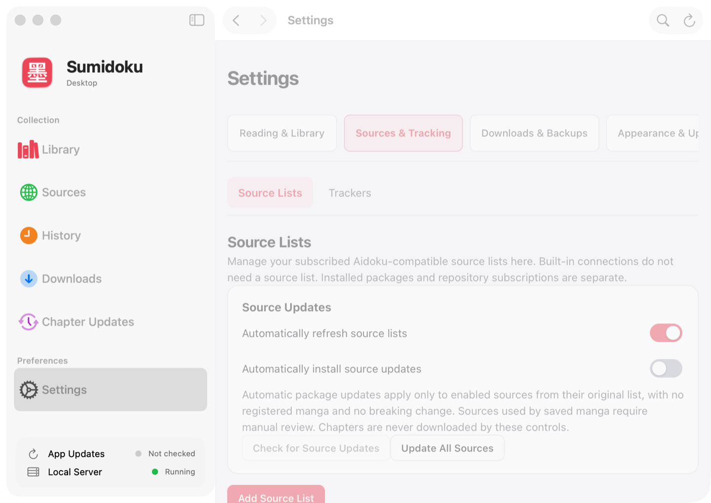
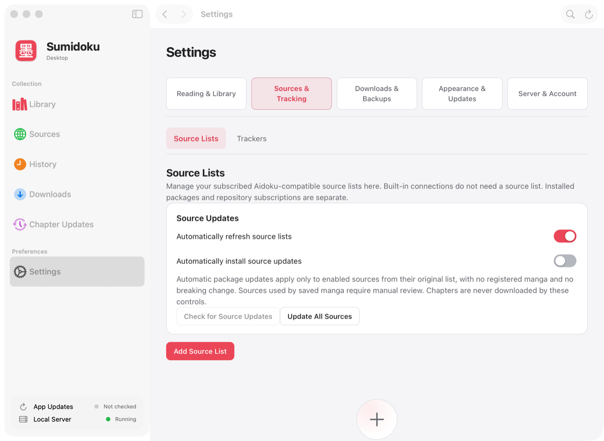

# Sumidoku Desktop 1.3.1 — sidebar and Settings redesign

**Status:** Mac build and native sidebar verification completed on PR #4. The 1.3.1 (7) application is
built in staging; the installed 1.3.0 (6), existing server and library are preserved.
No merge to `main`, release, service replacement or library migration is authorized
by this verification.

## Navigation

The native macOS `NavigationSplitView` sidebar now has exactly six destinations:

- Library
- Sources
- History
- Downloads
- Chapter Updates
- Settings

The first five are grouped under Collection. The one Settings entry is under
Preferences, replacing the ten individual Settings links. The same six
destinations are exposed by the browser-only fallback sidebar. This change does
not remove any old settings routes.

Original Sumidoku logo retained, displayed at 48pt with a larger name and
subtle Desktop caption. Native navigation glyphs are OS-rendered SF Symbols
chosen from Aidoku's original navigation system, at 22pt with restrained tints:
red Library, green Sources, orange History, blue Downloads, purple Updates,
neutral Settings. Native row height is at least 48pt. The sidebar's ideal
width is 270pt and is resizable. High contrast and the existing Liquid Glass
runtime fallback still use the platform's native surfaces. No Aidoku raster
assets or additional icon packs are bundled.

## Five Settings categories (web content under the native shell)

| Category | Existing subsections |
| --- | --- |
| Reading & Library | Reader, Library & Categories |
| Sources & Tracking | Source Lists, Trackers |
| Downloads & Backups | Downloads, Backups & Imports |
| Appearance & Updates | General, including theme and native application update bridge |
| Server & Account | System, security, API keys, caches, logs/about; native Server & Account controls via the local-only desktop bridge |

Each category has its own top-level button; categories with multiple sections
have a second row of subsection controls. The old `?section=general`,
`reader`, `library`, `trackers`, `downloads`, `backups`,
`source-lists` and `system` URLs stay valid and select the corresponding
category. All eight panel components remain mounted (inactive sections hidden)
so switching to Source Lists does not discard a selected Aidoku backup file.

The native `server` message is accepted only by the existing main-frame,
localhost-checked `WKScriptMessageHandler`. No new local service or network
endpoint has been created.

## Native sidebar footer

A single, compact native material surface contains two buttons:

- **App Updates:** actual update state and colored status. Neutral when unverified,
  green when verified current, orange when available, red for actual errors.
  The visible text is abbreviated for the sidebar and the accessibility label
  contains the complete result. Opens the existing native Updates panel.
- **Local Server:** actual server availability and colored state text. Opens
  the existing native Server & Account panel.

Status controls do not trigger an update or change the background service.

## Version

`macos/build-app.sh` sets **1.3.1 (7)** for development builds from this
branch. The user's currently installed 1.3.0 (6) remains unchanged.
No public 1.3.1 release or signed feed is published.

## Required before merge/install

Run on the Mac against a disposable test library first:

```sh
npm --prefix webui ci
npm --prefix webui run check
npm --prefix webui test
export CARGO_BUILD_JOBS=1
export CARGO_TARGET_DIR="${TMPDIR:-/tmp}/sumidoku-fork-target"
./macos/build-fork.sh
export SUMIDOKU_SERVER_BINARY="$PWD/dist/fork/sumidoku-server"
cargo nextest run --workspace
cargo clippy --workspace --all-targets -- -D warnings
python3 -m unittest discover -s macos/tests -p 'test_*.py'
./macos/test-app.sh
./macos/test-updates.sh
./macos/test-community.sh
./macos/test-symbols.sh
./macos/test-onboarding.sh
./macos/test-onboarding.sh --launchagent
python3 macos/test-desktop.py
python3 macos/test-sources.py
./macos/test-welcome.sh
python3 macos/smoke-test.py
```

Freeze the built frontend and executable while these tests run. The binary override
ensures fixtures use this build rather than the installed official server. Run cold
release/debug Rust builds sequentially to keep memory use bounded.

Additional manual checks:

1. Visually inspect a real unlocked native window in light/dark, larger text,
   high contrast and reduced transparency. The original Sumidoku icon must
   remain unchanged.
2. Select each of the six sidebar entries and five Settings categories; use
   both internal Settings subsections and browser back/forward. Verify the
   selected state and no duplicate visible sidebar in WKWebView.
3. Open an existing Aidoku backup, navigate to Settings → Sources & Tracking →
   Source Lists and return. The backup file and exact-ID recovery state must
   survive. Confirm explicit removal choices still preserve library/progress.
4. Click App Updates and Local Server footer controls and verify that actual
   statuses and panel destinations are correct. Force offline/checking/error
   states; no false green state.
5. Confirm authenticated restart, one managed localhost server, account,
   library, categories, reading progress, sources, downloads and backups.
6. The app should not download chapters, install updates automatically or
   change signing policy as part of this UI-only change.

## Mac verification results

The first full frontend run found missing category translations in nine locales
and two tests still asserting the old flat Settings navigation. The Python symbol
suite also pinned the removed individual native settings rows. The locale catalogs
and regression assertions were corrected without removing any legacy panel/route.
The unchanged locale-coverage test was deliberately broken from committed green by
removing one German category key; it failed on that exact missing key, then passed
after a single-file restore.

- Frontend: **378 passed**; TypeScript check and production build passed.
- Python maintenance/static regressions: **29 passed**.
- Native navigation **12**, update/material policies **37**, community bootstrap **9**,
  native symbols **6 resolutions + 2 fallback cases** passed.
- Native fixture: six destination selection bindings; own-window clicks on both
  footer buttons; four fixture release outcomes (offline, malformed/error, empty
  catalog/unverified, update available), each passing through Checking; five
  visible Settings categories, eight persistent panels, subsections/back-forward,
  independent source preferences and exact-byte Aidoku backup resume all passed.
- Actual unlocked native window captures passed in light/dark, a 920×640 window,
  high-contrast appearance and an enlarged web-content preview. No duplicate browser
  sidebar is visible. Original Sumidoku logo/red theme and native materials remain.
- Staged native **1.3.1 (7)** passes strict/deep signature verification. The six
  embedded index/assets match the built frontend byte for byte; the packaged
  server digest matches the fork manifest. Runtime build revision is `8d99f93`;
  later changes contain only verification drivers, captures and documentation.
- Onboarding/authenticated restart: **32 assertions each** through direct-process
  and temporary LaunchAgent drivers. Backup/source smoke passed exact-ID Aidoku
  import, invalid-backup rejection, export/restore, categories/progress, restart
  persistence and zero downloads. All fixture data is disposable.
- Source UI: all four built-in setup/test forms, grouped Source Lists and add-list
  controls passed against the final embedded frontend. Welcome/create/sign-in
  views rendered without creating a real account.
- The installed 1.3.0 (6) and its managed localhost server were not replaced or
  restarted. Private preservation fingerprints for the actual library, credentials,
  progress, settings, source records, configuration/key files, downloads, backups,
  descriptor and official executable still match the pre-verification baseline.
- Rust test compilation completed. Full nextest execution was stopped before
  completion; strict Clippy was not run. Neither is claimed as passing.

### Visual evidence

These are captures of the running native fixture with original disposable comic
art, resized for documentation; no personal library or credentials are included.







The large-text preview sets WebKit zoom to 135%. Native rows currently specify
point sizes explicitly, so this is not
certification of native text scaling under every macOS accessibility setting.
Reduced-transparency/forced-material policies are checked using the native control
fixture; system-wide accessibility preferences were not changed. Actual older
hardware, global accessibility setting changes and a reboot remain manual checks.

Unsigned automatic app installation remains disabled. Release metadata transport
is fixture-only in native UI tests; neither packages nor manga chapters are
fetched automatically by this verification. Keep PR #4 draft and do not install
over the current application, merge or publish until separately approved.
